# Net2Map

> **Note:** This project is "vibe coded" — the code was written iteratively with AI assistance.

Net2Map is a web application for discovering and visualizing switch topologies via SNMP.
Up to v2.x the project was called NetMap; upgrade instructions from v2.x to v3.0.0 are in
`docs/OPERATIONS.md` ("Upgrading from NetMap (v2.x) to Net2Map (v3.0.0)").
The project consists of a FastAPI backend (scan, persistence, API) and a React/Vite frontend (map, rack view, settings).

## Features

- SNMP scan of devices via SNMPv2c and SNMPv3, separate intervals for discovery, LLDP links and MAC tables; discovery IP ranges and DNS resolvers (PTR) configurable
- Automatic vendor detection with dedicated scanners (Aruba CX, Cisco, FS.com, OPNsense, UniFi, Generic)
- Firmware version capture per device (ENTITY-MIB OID, with vendor parsing from sysDescr as fallback)
- Interactive topology map (React Flow) based on LLDP links, including port/speed info, auto-layout, device search, minimap and optional background image; layers "STP" (root bridge, root paths, blocked ports), "VLAN" and "Latency"
- Endpoint tracking under `/devices`: MAC, IP, hostname and switch port per end device, including port history and ignoring
- Network device overview under `/network` with rack, class, model, firmware and status
- Rack elevation under `/racks`: real U positions (U1 at the bottom), drag and drop with preview, adjustable device height (`u_height`)
- Dashboard with status cards, "Attention needed" list, deep links and live scan display
- Inspector sidebar for switches, endpoints and racks (linkable via `?inspect=`) and command palette (`Ctrl/Cmd+K` or `/`)
- Scan history with changes per run, duration per switch and dry-run preview
- Users and roles (admin, operator, viewer), audit log, log view under `/logs`
- CSV/JSON import/export as well as export/import of the complete configuration
- Dark/light theme (Tailwind design system, toggle in the sidebar)
- Manual metadata adjustment per device (e.g. vendor/model), switch classes and hardware models with port layout
- Network latency monitor: a dedicated service pings the devices continuously (every 10 s by default) and shows latency, jitter, packet loss and deviation from the 24 h baseline in the dashboard, in the inspector (with history 1 h / 24 h / 7 d) and as the topology layer "Latency"

## Screenshots

Captured with generated demo data from a local demo stack (not part of the
repository; see `docs/OPERATIONS.md`, section "Demo stack").

**Dashboard** (light and dark)

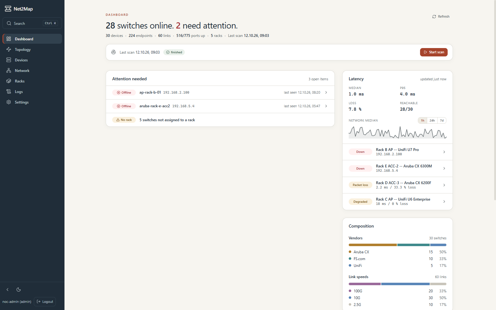
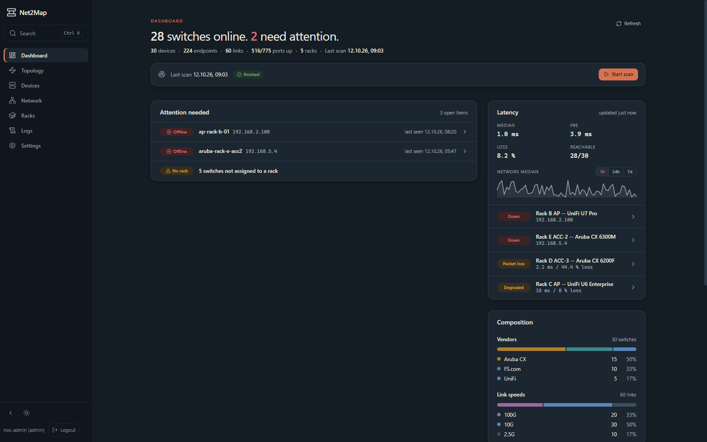

**Topology map** with the layers VLAN, STP and Latency

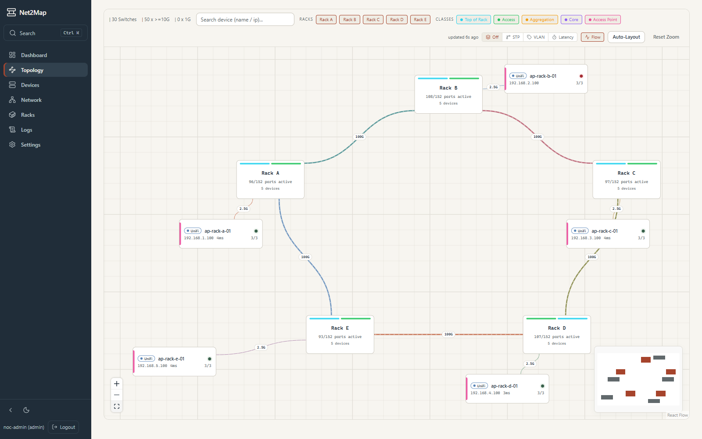
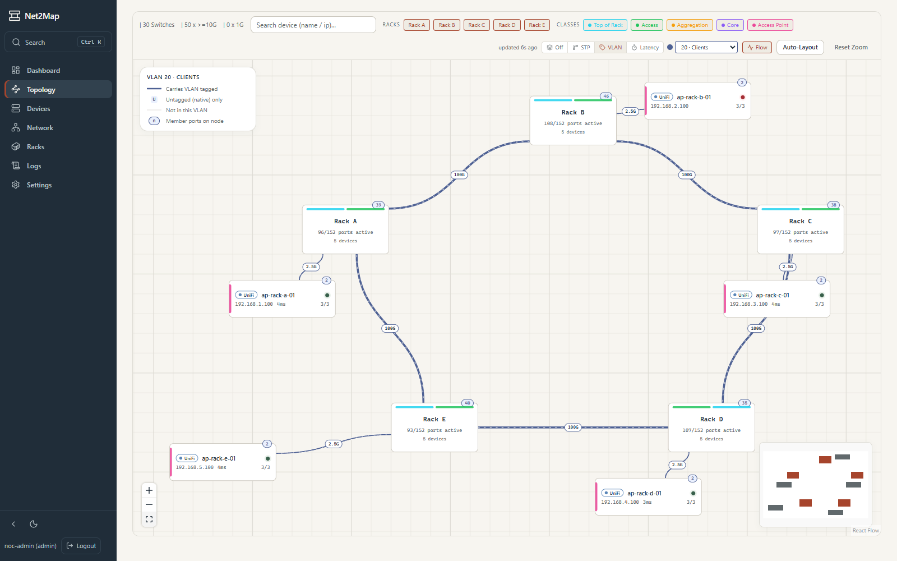
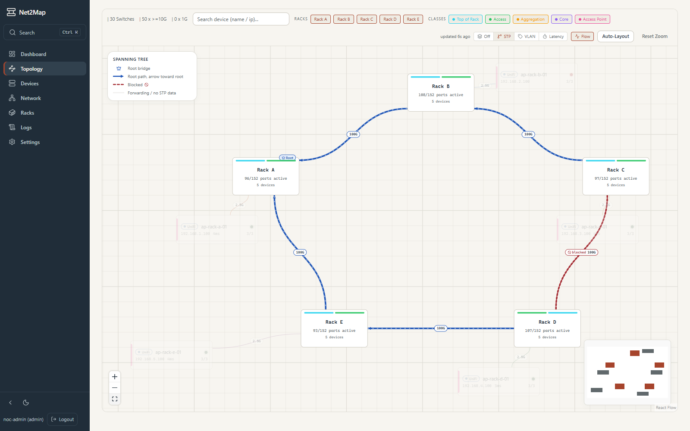
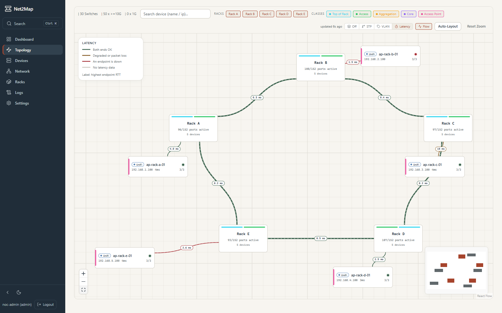
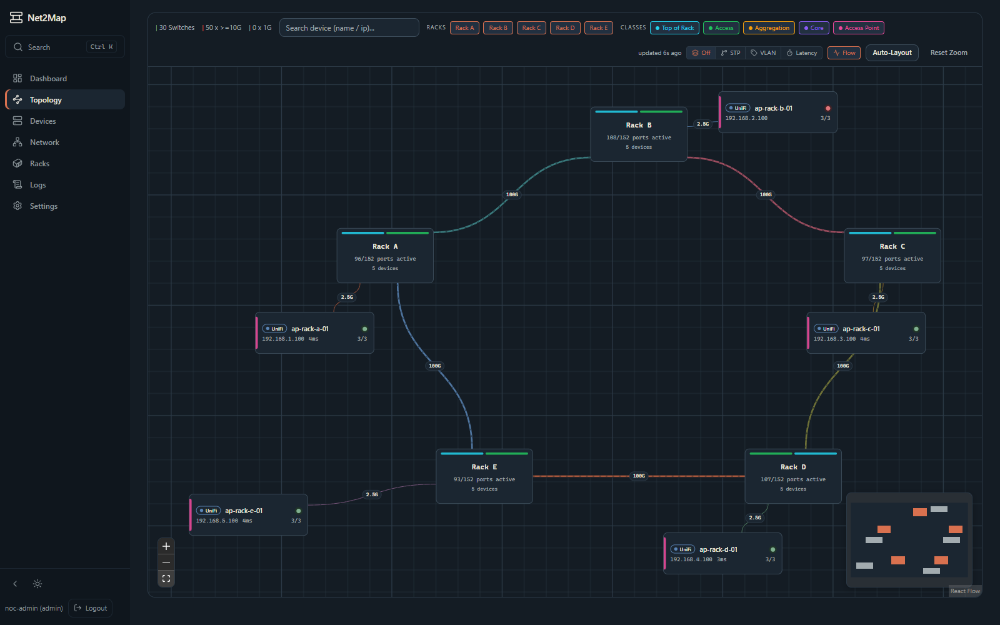

**Inspector and command palette**

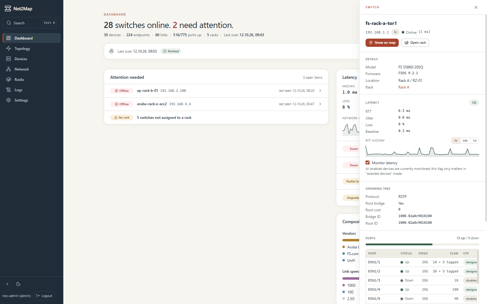
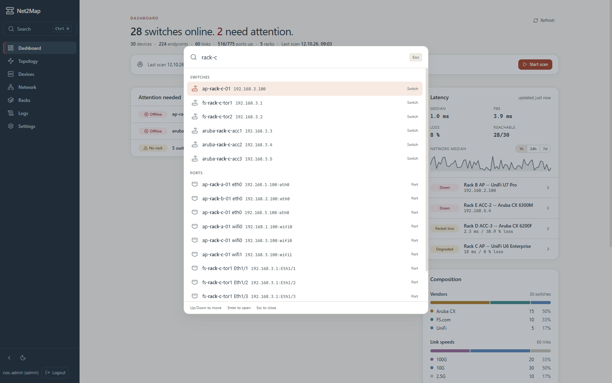

**Network devices, endpoints and racks**

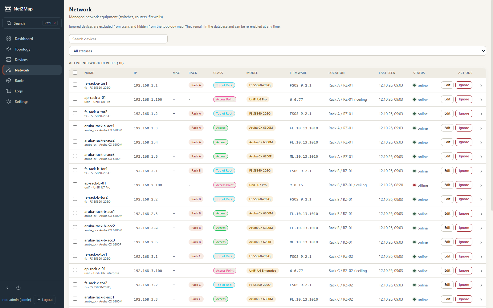
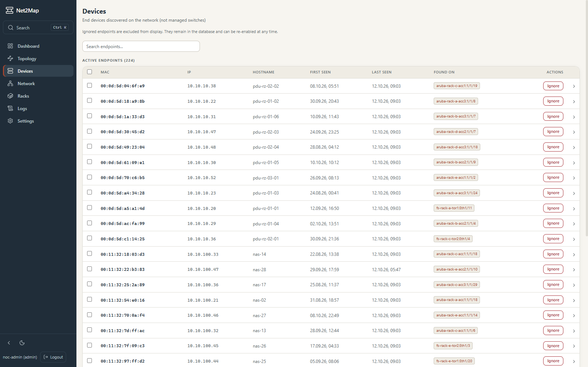
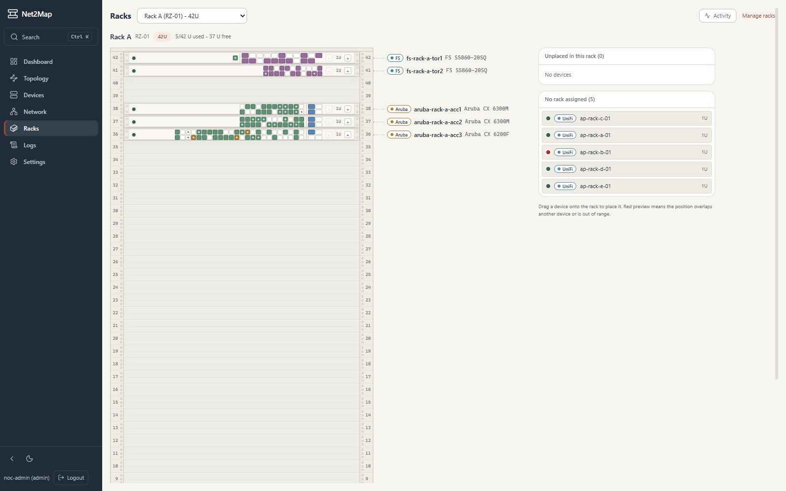

**Scan settings and logs**

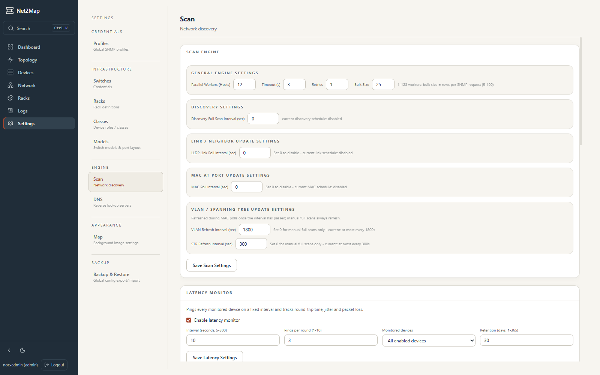
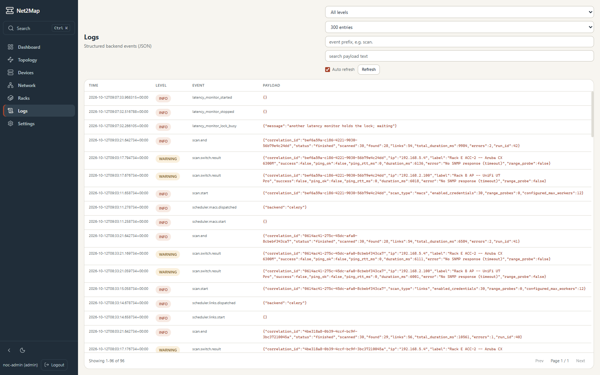

## Architecture

- `backend/` – FastAPI + SQLAlchemy + SNMP Scanner
- `frontend/` – React + Vite + TypeScript (Tailwind v4, TanStack Query, React Flow), served via Nginx in the Docker setup
- `docker-compose.yml` – Starts frontend and backend together (plus PostgreSQL, Redis, Celery worker/beat and the latency monitor `latency-monitor`)

Further documentation: `docs/API.md` (API reference), `docs/OPERATIONS.md` (operations, deployment, environment variables); overview in `docs/README.md`.

## Quickstart with Docker

Prerequisite: Docker + Docker Compose

```bash
cp .env.example .env   # set POSTGRES_PASSWORD, SECRET_TOKEN, DEFAULT_ADMIN_PASSWORD (required)
docker compose up -d
```

This pulls the prebuilt images of the newest release from the GitHub Container
Registry (`ghcr.io/mainzerp/net2map/backend` and `/frontend`, public, no login
needed). To pin a release, set `NET2MAP_VERSION` in `.env` (e.g. `v3.2.1`; default
`latest`).

Update to the newest release:

```bash
git pull
docker compose pull && docker compose up -d
```

To run your local checkout instead (development, unreleased changes), build the
images from source with the local override `docker-compose.local.yml`:

```bash
docker compose -f docker-compose.yml -f docker-compose.local.yml up --build -d
```

> **Note:** Pass both `-f` files to every later command (`ps`, `logs`, `down`). The
> local images are named `net2map-backend` / `net2map-frontend`, so they never
> replace the pulled release images. If old assets show up after a build, rebuild
> without cache: `docker compose -f docker-compose.yml -f docker-compose.local.yml build --no-cache`.

The UI listens on host port 3000; set `NET2MAP_PORT` in `.env` to use another port.

The UI is then available at:

- http://localhost:3000
- API documentation (OpenAPI/Swagger UI): http://localhost:3000/docs (can be disabled
  with `OPENAPI_ENABLED=false`; API calls still require a token)

Optional settings (e.g. `LOG_LEVEL`, `JWT_EXPIRY_HOURS`,
`AUDIT_RETENTION_DAYS`, `UVICORN_WORKERS`) are listed as comments in `.env.example`
and are passed through to the containers by Compose.

PostgreSQL stores the database persistently in the Docker volume `net2map_pgdata`.
The volume `net2map_data` contains the files stored under `/data`.

Stop:

```bash
docker compose down
```

Including deletion of the DB volume:

```bash
docker compose down -v
```

## Local Development (without Docker)

### Backend

```bash
cd backend
python -m venv .venv
# Windows
.venv\Scripts\activate
# Linux/macOS
# source .venv/bin/activate
pip install -r requirements.txt
uvicorn main:app --reload --host 0.0.0.0 --port 8000
```

### Frontend

Prerequisite: Node.js 24 (as in the Docker build and in CI); alternatively Node.js
22 from version 22.12. The frontend manifest defines these supported versions.

```bash
cd frontend
npm install
npm run dev
```

Vite runs at http://localhost:5173 by default.

Optionally, the backend URL can be set via `VITE_API_URL`.

## Typical Workflow

1. Create SNMP credentials/profiles in the settings
2. Start a scan
3. Check devices, links and racks in the map
4. If needed, manually correct vendor/model per device

## API Versioning

- The canonical prefix of the backend API is `/api/v1` (e.g. `GET /api/v1/devices`).
  The OpenAPI documentation (`/docs`, in the Docker setup http://localhost:3000/docs)
  lists only the `/api/v1` paths.
- The unversioned prefix `/api/...` remains as a **deprecated alias** and
  returns identical responses. Every response through it additionally contains
  `Deprecation: true` and `Link: </api/v1/...>; rel="successor-version"` (same
  remaining path including query string). New clients should use only `/api/v1`.
- `GET /health`, `GET /metrics` and the WebSocket
  `/ws/scan-progress` remain unversioned. `GET /health` checks only the database and Redis (container
  healthcheck); `GET /health?deep=1` additionally checks the Celery workers.
- The frontend internally works with logical `/api/...` paths and maps them centrally
  to `/api/v1/...` in `frontend/src/api.ts`.

## Scan Settings and Metrics

- The number of parallel SNMP queries is configurable in the UI under `Settings -> Scan`.
- Backend API for scan workers: `GET/PUT /api/v1/scan-settings` with `max_workers`, `snmp_timeout`, `snmp_retries` and `snmp_bulk_size` (rows per SNMP request, 5-100, default 25).
- Link and MAC scans read interface names and aliases from a cache and walk only status and speed; the names are re-read at most once per discovery interval (or for an unknown ifIndex).
- VLAN and STP data have their own intervals (`Settings -> Scan`, default 1800 s and 300 s respectively). They are updated in MAC scans as soon as their interval has expired; `0` means only during manual full scans.
- DNS resolvers for PTR lookups are configurable in the UI under `Settings -> DNS`.
- Backend API for DNS servers: `GET/PUT /api/v1/dns-settings` with `servers` (IP list).

The scan result (`POST /api/v1/scan`) contains additional runtime data:

- `max_workers`: effective number of workers used
- `total_duration_ms`: total duration of the scan run
- `switch_metrics[]`: duration and status per switch (`ip`, `label`, `duration_ms`, `success`, `error`)

## Tech Stack

- Backend: FastAPI, SQLAlchemy, Pydantic, PySNMP
- Frontend: React, React Router, Vite, TypeScript, Tailwind CSS v4, TanStack Query, @xyflow/react
- Deployment: Docker, Nginx

## Configuration

`VITE_API_URL` is baked into the frontend bundle at build time.
To point the frontend at a different backend URL, rebuild the image:
```bash
docker buildx build --build-arg VITE_API_URL=http://your-backend:8000 -t net2map-frontend .
```

## Security

- **Authentication:** `JWT_SECRET` enables user accounts and roles. The
  static `SECRET_TOKEN` is an alternative mode without JWT. Without either value,
  the API endpoints are reachable without login.
- **Session revocation:** JWT revocations require Redis. If Redis is configured but
  unreachable, JWT checks fail with `503 AUTH_UNAVAILABLE`.
  Without Redis, login and normal JWT access remain possible; logout,
  session revocation as well as security-relevant user changes and deletions
  report `503` instead of pretending a successful revocation.
  Failed user changes are not saved. The UI still logs out
  locally and indicates that the server-side revocation failed.
- **WebSockets:** Existing scan connections re-check their original
  credentials five seconds after the last successful check,
  even without incoming messages. Expiry or revocation closes the connection with code `1008`;
  an unavailable auth service with `1011`. One-time tickets are consumed only when
  the connection is established; after that, the associated session is checked.
  Redis connections each have a two-second connect and response timeout without
  automatic retry. Socket authentication runs outside the
  event loop with a total timeout of five seconds; the check duration is added to the
  interval.
- **Redis persistence:** Compose uses `net2map_redisdata` and AOF with
  `appendfsync everysec`. In a crash, about one second of writes
  can be lost. After losing Redis data or restoring stale Redis data,
  rotate `JWT_SECRET` so that previously revoked tokens do not become valid again.
- **Proxy trust:** Nginx replaces incoming `X-Forwarded-For` with the
  direct peer. Behind an additional reverse proxy, that proxy's IP therefore
  applies to the rate limit. Only adopt real client IPs with explicitly configured,
  trusted proxy addresses; do not expose the backend port
  publicly.
- **HTTPS:** Provide TLS via a reverse proxy in front of the frontend;
  the bundled containers do not offer HTTPS themselves.
- **SNMP credentials:** API responses mask communities and SNMPv3 passwords.
  `ENCRYPTION_KEY` encrypts these values in the database. A key
  is generated by `python -c "from cryptography.fernet import Fernet; print(Fernet.generate_key().decode())"`.
- **SNMP protocol:** For new profiles, use SNMPv3 with authentication and
  encryption (`authPriv`, SHA-256/AES). V2c and V3 without
  encryption remain available for explicitly configured legacy devices;
  community strings in V2c are transmitted unencrypted over the network.

## Production Deployment

Before deploying Net2Map to production, ensure the following requirements are met:

1. **TLS/HTTPS**: Net2Map does not include built-in TLS. You MUST place a TLS-terminating reverse proxy in front of the application. See the TLS / HTTPS Setup section below.
2. **Authentication**: Compose always requires `SECRET_TOKEN`; additionally set `JWT_SECRET` (recommended) to enable user accounts and roles. With `JWT_SECRET` set, the static `SECRET_TOKEN` is no longer accepted for API calls.
3. **Encryption at Rest**: Set `ENCRYPTION_KEY` to encrypt SNMP passwords in the database. Without it, passwords are stored in plaintext.
4. **Strong Passwords**: Use strong, unique values for `POSTGRES_PASSWORD`, `DEFAULT_ADMIN_PASSWORD`, and all secrets. Never use the example values in production.
5. **CORS**: Set `CORS_ORIGIN` to your actual domain (e.g. `https://net2map.example.com`). Do not use `*` in production.

## TLS / HTTPS Setup

Net2Map ships without TLS. To secure traffic in production, place a TLS-terminating reverse proxy in front of the frontend container. Common options:

### Option A: Caddy (automatic HTTPS)

```
# Caddyfile
net2map.example.com {
    reverse_proxy frontend:80
}
```

Run Caddy alongside docker-compose. It will obtain and renew Let's Encrypt certificates automatically.

### Option B: Traefik

Add Traefik labels to the `frontend` service in `docker-compose.yml`:

```yaml
labels:
  - "traefik.enable=true"
  - "traefik.http.routers.net2map.rule=Host(`net2map.example.com`)"
  - "traefik.http.routers.net2map.tls.certresolver=letsencrypt"
```

### Option C: nginx with TLS

Create an `nginx-ssl.conf` with:

```nginx
server {
    listen 443 ssl;
    server_name net2map.example.com;

    ssl_certificate     /etc/ssl/certs/net2map.pem;
    ssl_certificate_key /etc/ssl/private/net2map.key;
    ssl_protocols       TLSv1.2 TLSv1.3;
    ssl_ciphers         HIGH:!aNULL:!MD5;

    location / {
        proxy_pass http://frontend:80;
        proxy_set_header Host $host;
        proxy_set_header X-Real-IP $remote_addr;
        proxy_set_header X-Forwarded-For $proxy_add_x_forwarded_for;
        proxy_set_header X-Forwarded-Proto $scheme;
    }
}
```

For any option, update `CORS_ORIGIN` in `.env` to match the HTTPS URL (e.g. `https://net2map.example.com`).

## Dependency Management

### Backend (Python)

Direct dependencies are listed in `backend/requirements.txt`. For production deployments, consider using `pip-tools` to lock transitive dependencies:

```bash
pip install pip-tools
pip-compile requirements.txt -o requirements.lock
```

### Frontend (Node.js)

`frontend/package-lock.json` is committed to the repository. It pins every
transitive dependency so that Docker builds (and CI) always install the exact
same versions via `npm ci`.

**Updating dependencies:**

```bash
cd frontend
npm install            # updates package-lock.json
npm audit fix          # optional -- apply security patches
```

Commit the updated `package-lock.json` together with any `package.json` changes.

### Security Checks and Build Gate

The GitHub workflow `.github/workflows/ci.yml` runs checks on pushes to `main`,
on `v*` tags and on pull requests against `main`:

- `pip-audit`: all resolved backend dependencies, without advisory exceptions.
- `npm audit`: all severity levels, including development dependencies.
- Bandit: Python production code from severity `medium`, all confidence levels;
  test files are excluded. The deliberately supported legacy SNMP protocols
  carry only justified exceptions for their respective rule.

A finding or a scan error makes `security-scan` fail. Both Docker jobs
(`docker-build` and `docker-push`) require its successful completion;
failed, cancelled or skipped scans prevent build and push.
Image pushes remain restricted to `v*` tags. Job permissions are reduced to
read; only the publish job gets write access to packages.

Run the same checks locally:

```bash
# Python backend
pip install pip-audit==2.10.1 bandit==1.9.4
pip-audit -r backend/requirements.txt --strict
bandit -r backend --exclude backend/tests --severity-level medium --confidence-level all

# Frontend
cd frontend
npm ci --include=dev
npm audit --include=dev --audit-level=info
```
